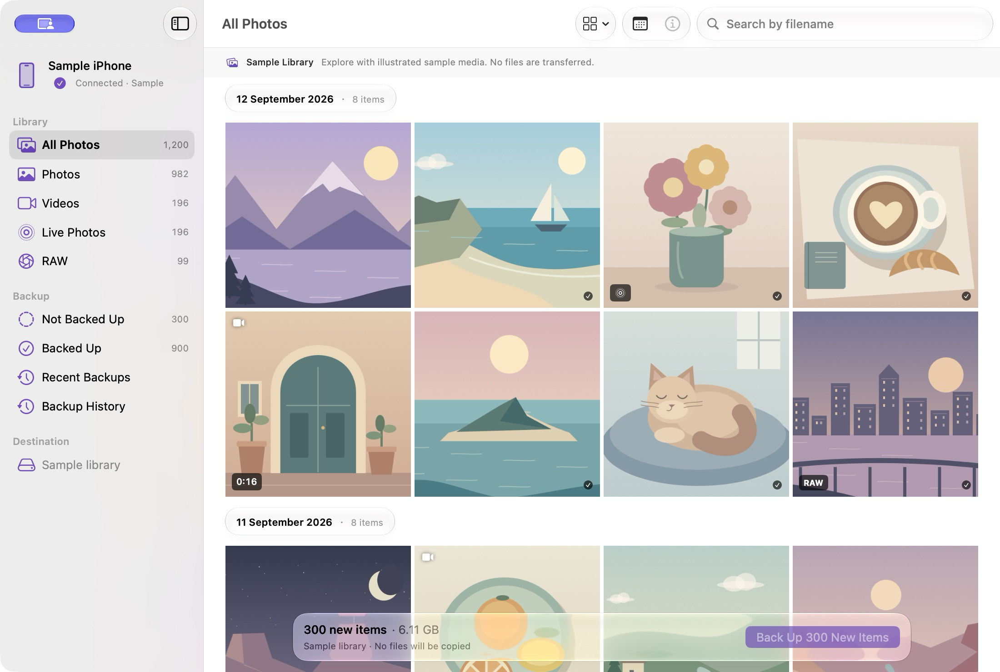

# CloakRoll

**Your camera roll, safely on your Mac.**

[Website](https://roll.cloakyard.com/) · [Source](https://github.com/cloakyard/cloakroll) · [Support](https://ko-fi.com/sumitsahoo21)

<p align="center">
  <a href="LICENSE"></a>
  
  
  
  
</p>

<p align="center">
  <picture>
    <source media="(prefers-color-scheme: dark)" srcset="assets/screenshots/library-dark.png">
    
  </picture>
</p>

## Overview

A native macOS app for backing up iPhone photos and videos over USB. Browse the library and copy original components into folders you control. The SwiftUI app is separate from the Air website.

## Features

| Capability | Implementation |
|---|---|
| **Browse your iPhone** | Photos, videos, RAW and Live Photos exposed over USB; filename search, capture-date filtering, chronological groups and three thumbnail sizes. |
| **Keep originals** | Copies original components, including [Live Photo companions](docs/LIVE-PHOTOS.md), without conversion or deletion on the phone. |
| **Incremental backups** | Device- and destination-scoped evidence, with fresh local size/SHA-256 checks before reusing a saved original. Missing or changed files stay eligible for backup. |
| **Organize multiple iPhones** | Each stable iPhone identity remembers its selected folder. New files use a separate device folder, with Year/Month or One Folder organization. |
| **Follow progress** | Compact Liquid Glass controls, measured progress in the app and Dock, a stable heading and Stop. Completed components remain recorded if later work fails. |
| **Review history** | Offline sessions, iPhone/result filters, paging, original counts and read-only saved-file checks. |
| **Recover lost history** | Rebuild from a backup folder’s portable recovery records. Older media-only folders can use one-time size/hash verification over USB. |
| **Inspect and select** | Camera/lens, ISO, aperture and other supplied metadata; Info navigation, range/date-group selection and quick deselection. |
| **Feel at home on Mac** | Native menus, keyboard actions, light/dark appearance and system materials; photos scroll beneath the toolbar. Designed for macOS 26 and later. |

### Current boundaries

A USB library includes only media exposed by the iPhone. iCloud-only or otherwise unavailable
originals may be absent; CloakRoll cannot claim complete iCloud Photos coverage. Photos albums
are not reconstructed from DCIM folders. Restore to a new iPhone remains in the
[backlog](docs/RESTORE-TO-IPHONE.md); no companion iPhone app is required for backup.

Bounded physical imports, incremental repeats, Stop, deferred Quit and history rebuilding have
recorded evidence. Final cable/removable-drive interruption, full-disk/remount, new-capture
reconnect, sustained scrolling/memory, complete assistive-technology and older-OS checks remain
open. See the [release checklist](docs/RELEASE.md). Automated tests do not close those gates.

### Troubleshooting

#### The iPhone does not appear

Unlock it, reconnect the cable, and accept Trust if asked. Check whether Apple’s Image Capture
can see it. **Help → About USB Availability** explains why some originals may be unavailable.

#### The backup folder moved or is unavailable

Reconnect the drive, or choose the original folder again. CloakRoll checks access and never
silently redirects a backup. Right-click the destination to **Open in Finder**.

#### App data or backup history was lost

Open **Backup History → Rebuild History…** and select the backup folder. Keep its hidden
`.cloakroll-recovery` records with the originals when moving it. Older folders without records
can be verified once with the source iPhone. Filenames alone are never treated as proof.

## Privacy

No accounts, analytics, automatic crash uploads, update checks or app-operated network services.
Media, previews, preferences and history stay on your Mac or in the folder you choose.
Original embedded metadata is preserved. A cloud-managed folder may sync through its own service.
External Help/About links open in your browser only when chosen. Read the
[privacy policy](docs/PRIVACY.md), also summarized in Settings → Privacy.

## Getting started

The published **0.1.0 beta, build 20261030**, is available on
[GitHub Releases](https://github.com/cloakyard/cloakroll/releases/tag/v0.1.0-beta.20261030),
with a DMG and SHA-256 checksum. The [beta notes](docs/releases/v0.1.0-beta.20261030.md)
record the features, verification and known limits; release binaries stay out of source control.

1. Download and open [CloakRoll-v0.1.0-beta.20261030.dmg](https://github.com/cloakyard/cloakroll/releases/download/v0.1.0-beta.20261030/CloakRoll-v0.1.0-beta.20261030.dmg).
2. Drag **CloakRoll** to **Applications**, then open it and eject the installer.
3. Connect and unlock your iPhone over USB, accepting Trust if prompted. Choose a backup folder.
4. Back up new items, or select items and back up the selection.

Requires **macOS 26 or later on Apple silicon**. Intel Macs are not supported. This beta is locally ad-hoc signed and
**not notarized**. If macOS blocks a trusted copy after your first launch attempt, see
[Apple’s opening guidance](https://support.apple.com/en-us/102445). Current runtime validation
is on Apple silicon with macOS 27; macOS 26 runtime acceptance remains open.

Keep another independent copy of irreplaceable originals while evaluating the beta.

### Published release and source

The October 30 beta adds **About → Buy me a coffee** and refreshes compatible project dependencies.
It retains original USB backups, incremental verification, bundled license notices and the Air
installer. See the [release audit](docs/verification/SUPPORT-BETA-2026-10-30.md) for checks,
dependency versions and remaining acceptance limits.

## Development

### Native app

Development uses **Xcode 27+**, Swift 6, [XcodeGen](https://github.com/yonaskolb/XcodeGen) and SwiftLint.

```sh
brew install xcodegen swiftlint
git clone https://github.com/cloakyard/cloakroll.git
cd cloakroll/apps/macos
GIT_CONFIG_COUNT=0 xcodegen generate
GIT_CONFIG_COUNT=0 xcodebuild -project CloakRoll.xcodeproj -scheme CloakRoll \
  -destination 'platform=macOS,arch=arm64' -configuration Debug \
  -derivedDataPath build/Verify build
open build/Verify/Build/Products/Debug/CloakRoll.app
```

`project.yml` is authoritative; the generated Xcode project is ignored. `GIT_CONFIG_COUNT=0`
avoids inherited agent Git configuration interfering with SwiftPM. See
[development instructions](docs/DEVELOPMENT.md) for sample UI, Apple silicon builds and tests.

| Layer | Choice |
|---|---|
| App | SwiftUI, AppKit and native system controls |
| Device access | Public ImageCaptureCore APIs |
| Core | Swift 6 actors, structured concurrency and Sendable models |
| Persistence | Pinned GRDB/SQLite; folder-owned recovery records |
| Verification | Original sizes, CryptoKit SHA-256 and exclusive file publication |
| Build and packaging | XcodeGen, SwiftLint, hdiutil and pinned build-time dmgbuild tooling |

GRDB 7.11.1 is the only third-party Swift dependency. Its exact revision is pinned, and its
MIT notice and privacy manifest ship in the app. The installer tools are build-only dependencies.

To prepare a dated beta and DMG, follow the setup in [Release](docs/RELEASE.md), then run:

```sh
scripts/prepare_beta.sh --build 20261030.1
```

This checks the same clean source revision between stages, runs tests/lint/builds and a 10k
metadata probe, packages an arm64-only Release app, validates the mounted DMG and writes
checksums and a build manifest. It does not publish a release.

### Verification

The public beta passed **403 core + 227 hosted app tests (630 Swift tests)**, five release-tool
tests, strict lint and fresh Debug/Apple silicon Release builds. The mounted DMG, packaged-app
launch and uploaded assets were also checked; see
[the release audit](docs/verification/SUPPORT-BETA-2026-10-30.md) for scope and remaining acceptance gates.

```sh
cd apps/macos/Packages/CloakRollCore
GIT_CONFIG_COUNT=0 swift test
```

Run hosted app tests, the normal Debug build and strict lint from `apps/macos` as described in
[Development](docs/DEVELOPMENT.md). Tests cover identity isolation, incremental verification,
companion files, collisions, interrupted publication, recovery, folder access and UI state.
Physical iPhone acceptance is recorded separately in [verification](docs/verification/).

### Website

The independent Air website is in [`apps/site`](apps/site/README.md). Its README documents Node/npm setup, browser verification and deployment; native tests do not verify website layouts.

## Design and assets

The website follows the portable [Air contract](DESIGN.md) and its pinned local bundle. The native app keeps SwiftUI, SF Symbols and macOS system conventions. Do not apply web control skins to native UI.

[Brand assets](assets/README.md) own the marks, installer artwork and synthetic screenshots. Website asset sync reads those checked-in sources; edit the sources rather than generated copies. Screenshots are examples, not evidence of a real transfer or backup.

## Project structure

```text
cloakroll/
├── apps/macos/
│   ├── App/                       # Native UI and presentation
│   ├── Packages/CloakRollCore/    # Models, catalog, capture, thumbnails, backup and persistence
│   ├── Tests/                    # Hosted app tests
│   ├── scripts/                  # Artwork, validation, scale probes and beta DMGs
│   └── project.yml               # XcodeGen source
├── apps/site/                    # Air landing page, static Astro + Cloudflare
├── assets/                       # Icon, Air installer artwork and synthetic screenshots
└── docs/                         # Guides, release notes and actual verification evidence
```

See [architecture](ARCHITECTURE.md), [artwork](assets/README.md) and the
[documentation index](docs/README.md).

## Deployment and releases

Publish website changes through tested `dev` → `main` PRs and keep `dev` updated. When dev also holds unrelated native work, use a separately reviewed website-only PR under the maintainer's approved exception, then merge main into dev without releasing that native work. The [website guide](apps/site/README.md#deployment-and-releases) records build and deployment commands.

Native release preparation is separate from website deployment. Follow the existing build/packaging and verification instructions above; publish binaries and checksums to [GitHub Releases](https://github.com/cloakyard/cloakroll/releases), not the source tree. Preserve documented signing, runtime and physical-device limits.

## Contributing

Read [AGENTS.md](AGENTS.md) and [DESIGN.md](DESIGN.md) before changes. See [CONTRIBUTING.md](CONTRIBUTING.md) for contribution and disclosure guidance. Keep changes bounded, preserve features and output, remove obsolete references, and record actual verification. Compare all applicable views in phone, tablet, laptop and desktop layouts, both themes.

The [family README standard](https://github.com/cloakyard/cloakyard/blob/main/docs/README_STANDARD.md) defines this document's section order. Support the project through [Buy me a coffee](https://ko-fi.com/sumitsahoo21).

## License

Released under the [MIT License](LICENSE). Third-party components retain their own licenses.

Built by [Sumit Sahoo](https://github.com/sumitsahoo), part of [Cloakyard](https://cloakyard.com/).
