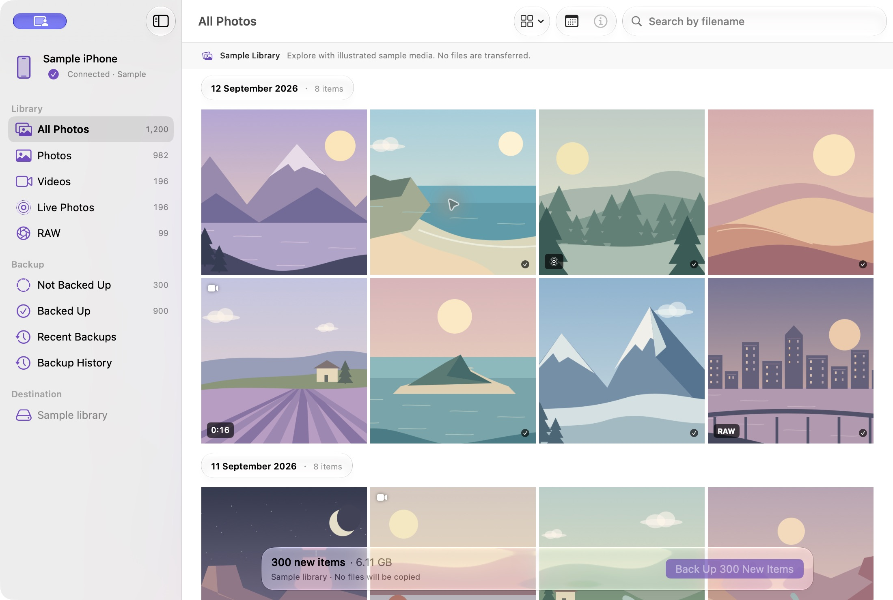

# CloakRoll

**Your camera roll, safely on your Mac.**

A native, open-source macOS app for backing up iPhone photos and videos over USB.
Browse your library, keep original files, and copy only what is missing into folders you control.
Built with SwiftUI and a separately tested Swift engine. No account, analytics or media uploads.

**[Beta notes](docs/releases/v0.1.0-beta.20261028.md)** · **[Releases](https://github.com/cloakyard/cloakroll/releases)** · **[Documentation](docs/README.md)** · **[Contributing](CONTRIBUTING.md)**

<p align="center">
  <a href="LICENSE"></a>
  
  
  
  
</p>

<p align="center">
  <picture>
    <source media="(prefers-color-scheme: dark)" srcset="assets/screenshots/library-dark.png">
    
  </picture>
</p>

Part of **[Cloakyard](https://github.com/cloakyard)**. Screenshots use the clearly labeled,
locally generated sample library; they contain no personal photos and do not show a real backup.

## Download and install

The **0.1.0 beta, build 20261028**, is prepared locally for evaluation. It has not yet been
published to GitHub Releases. The [beta notes](docs/releases/v0.1.0-beta.20261028.md) record the
artifact, checksum and validation; release binaries are kept out of source control.

1. Open the supplied `CloakRoll-v0.1.0-beta.20261028.dmg`.
2. Drag **CloakRoll** to **Applications**, then open it and eject the installer.
3. Connect and unlock your iPhone over USB, accepting Trust if prompted. Choose a backup folder.
4. Back up new items, or select items and back up the selection.

Targets **macOS 14+ on Apple silicon and Intel**. This beta is locally ad-hoc signed and
**not notarized**. If macOS blocks a trusted copy after your first launch attempt, see
[Apple’s opening guidance](https://support.apple.com/en-us/102445). Current runtime validation
is on Apple silicon with macOS 27; macOS 14 and Intel runtime checks remain open.

Keep another independent copy of irreplaceable originals while evaluating the beta.

## Version 0.1.0 beta

The first beta brings the implemented USB-backup workflow into a dated universal build,
with family-aligned Settings, bundled license notices and an Air drag-to-Applications installer.
See the [beta readiness audit](docs/verification/BETA-2026-10-28.md) for exact checks and limits.

## What it does

| Capability | Implementation |
|---|---|
| **Browse your iPhone** | Photos, videos, RAW and Live Photos exposed over USB; filename search, capture-date filtering, chronological groups and three thumbnail sizes. |
| **Keep originals** | Copies original components, including Live Photo companions, without conversion or deletion on the phone. |
| **Incremental backups** | Device- and destination-scoped evidence, with fresh local size/SHA-256 checks before reusing a saved original. Missing or changed files stay eligible for backup. |
| **Organize multiple iPhones** | Each stable iPhone identity remembers its selected folder. New files use a separate device folder, with Year/Month or One Folder organization. |
| **Follow progress** | Compact Liquid Glass controls, measured progress, a stable heading and Stop. Completed components remain recorded if later work fails. |
| **Review history** | Offline sessions, iPhone/result filters, paging, original counts and read-only saved-file checks. |
| **Recover lost history** | Rebuild from a backup folder’s portable recovery records. Older media-only folders can use one-time size/hash verification over USB. |
| **Inspect and select** | Camera/lens, ISO, aperture and other supplied metadata; Info navigation, range/date-group selection and quick deselection. |
| **Feel at home on Mac** | Native menus, keyboard actions, light/dark appearance and system materials; photos scroll beneath the toolbar. Liquid Glass uses native fallbacks on older macOS. |

### Current boundaries

A USB library includes only media exposed by the iPhone. iCloud-only or otherwise unavailable
originals may be absent; CloakRoll cannot claim complete iCloud Photos coverage. Photos albums
are not reconstructed from DCIM folders. Restore to a new iPhone remains in the
[backlog](docs/RESTORE-TO-IPHONE.md); no companion iPhone app is required for backup.

Bounded physical imports, incremental repeats, Stop, deferred Quit and history rebuilding have
recorded evidence. Final cable/removable-drive interruption, full-disk/remount, new-capture
reconnect, sustained scrolling/memory, complete assistive-technology and older-OS checks remain
open. See the [release checklist](docs/RELEASE.md). Automated tests do not close those gates.

## Troubleshooting

### The iPhone does not appear

Unlock it, reconnect the cable, and accept Trust if asked. Check whether Apple’s Image Capture
can see it. **Help → About USB Availability** explains why some originals may be unavailable.

### The backup folder moved or is unavailable

Reconnect the drive, or choose the original folder again. CloakRoll checks access and never
silently redirects a backup. Right-click the destination to **Open in Finder**.

### App data or backup history was lost

Open **Backup History → Rebuild History…** and select the backup folder. Keep its hidden
`.cloakroll-recovery` records with the originals when moving it. Older folders without records
can be verified once with the source iPhone. Filenames alone are never treated as proof.

## Privacy

No accounts, analytics, automatic crash uploads, update checks or app-operated network services.
Media, previews, preferences and history stay on your Mac or in the folder you choose.
Original embedded metadata is preserved. A cloud-managed folder may sync through its own service.
External Help/About links open in your browser only when chosen. Read the
[privacy policy](docs/PRIVACY.md), also summarized in Settings → Privacy.

## Build the app

Development uses **Xcode 27+**, Swift 6, [XcodeGen](https://github.com/yonaskolb/XcodeGen) and SwiftLint.

```sh
brew install xcodegen swiftlint
git clone https://github.com/cloakyard/cloakroll.git
cd cloakroll/apps/macos
GIT_CONFIG_COUNT=0 xcodegen generate
GIT_CONFIG_COUNT=0 xcodebuild -project CloakRoll.xcodeproj -scheme CloakRoll \
  -destination 'platform=macOS,arch=arm64' -configuration Debug \
  -derivedDataPath build/Verify build
open build/Verify/Build/Products/Debug/CloakRoll.app
```

`project.yml` is authoritative; the generated Xcode project is ignored. `GIT_CONFIG_COUNT=0`
avoids inherited agent Git configuration interfering with SwiftPM. See
[development instructions](docs/DEVELOPMENT.md) for sample UI, Intel build destinations and tests.

| Layer | Choice |
|---|---|
| App | SwiftUI, AppKit and native system controls |
| Device access | Public ImageCaptureCore APIs |
| Core | Swift 6 actors, structured concurrency and Sendable models |
| Persistence | Pinned GRDB/SQLite; folder-owned recovery records |
| Verification | Original sizes, CryptoKit SHA-256 and exclusive file publication |
| Build and packaging | XcodeGen, SwiftLint, hdiutil and pinned build-time dmgbuild tooling |

GRDB 7.11.1 is the only third-party Swift dependency. Its exact revision is pinned, and its
MIT notice and privacy manifest ship in the app. The installer tools are build-only dependencies.

To prepare a dated beta and DMG, follow the setup in [Release](docs/RELEASE.md), then run:

```sh
scripts/prepare_beta.sh --build 20261028
```

This checks a clean source commit, runs tests/lint/builds, packages a universal Release app,
validates the mounted DMG and writes checksums and a build manifest. It does not publish a release.

## Testing

```sh
cd apps/macos/Packages/CloakRollCore
GIT_CONFIG_COUNT=0 swift test
```

Run hosted app tests, the normal Debug build and strict lint from `apps/macos` as described in
[Development](docs/DEVELOPMENT.md). Tests cover identity isolation, incremental verification,
companion files, collisions, interrupted publication, recovery, folder access and UI state.
Physical iPhone acceptance is recorded separately in [verification](docs/verification/).

## Repository layout

```text
cloakroll/
├── apps/macos/
│   ├── App/                       # Native UI and presentation
│   ├── Packages/CloakRollCore/    # Models, catalog, capture, thumbnails, backup and persistence
│   ├── Tests/                    # Hosted app tests
│   ├── scripts/                  # Artwork, validation, scale probes and beta DMGs
│   └── project.yml               # XcodeGen source
├── assets/                       # Icon, Air installer artwork and synthetic screenshots
└── docs/                         # Guides, release notes and actual verification evidence
```

See [architecture](ARCHITECTURE.md), [artwork](assets/README.md) and the
[documentation index](docs/README.md).

## Contributing and license

Read [CONTRIBUTING.md](CONTRIBUTING.md) and report reproducible issues through
[GitHub Issues](https://github.com/cloakyard/cloakroll/issues). Exclude private media and device data.

CloakRoll source is released under the [MIT License](LICENSE). Third-party components retain
their own licenses. Built by Sumit Sahoo as part of [Cloakyard](https://github.com/cloakyard).
